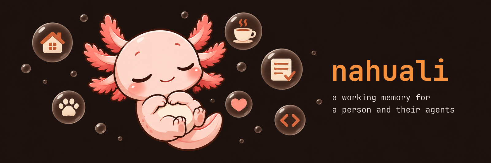
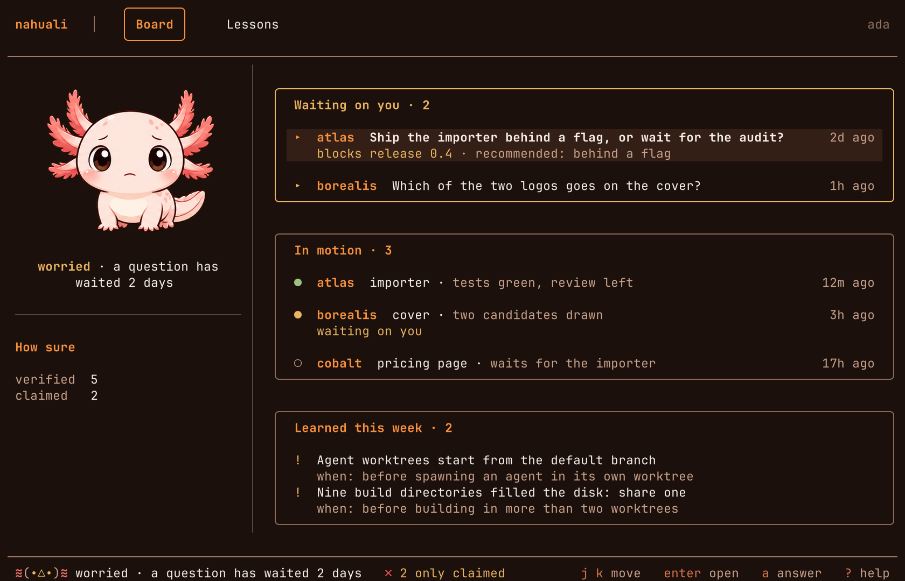
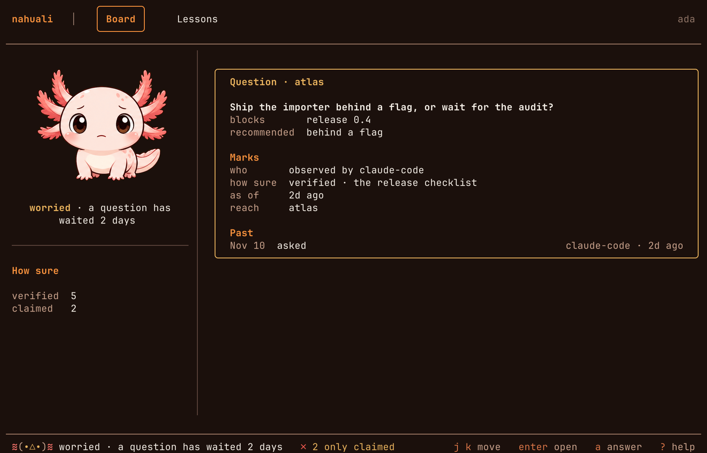
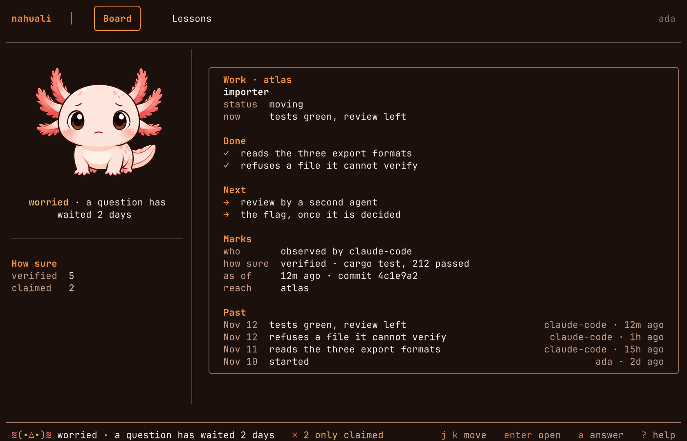
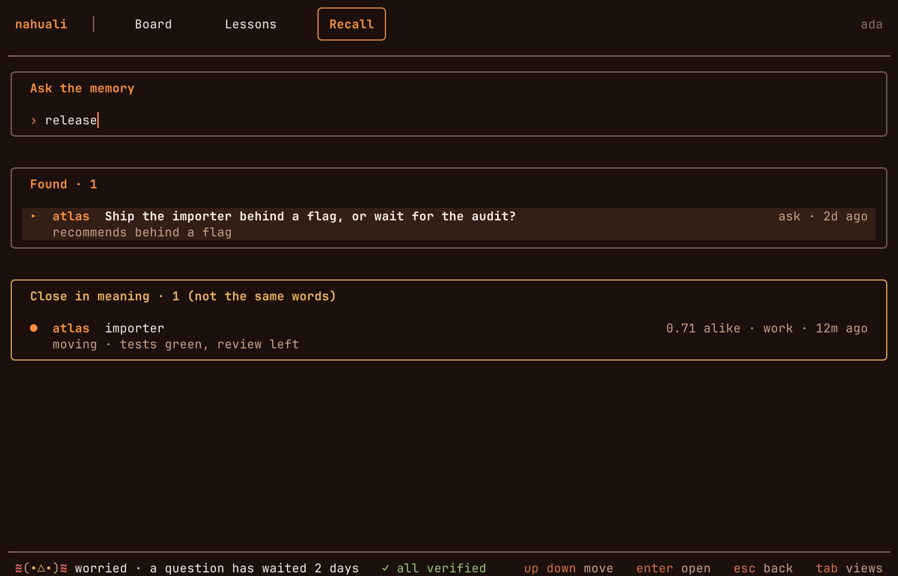
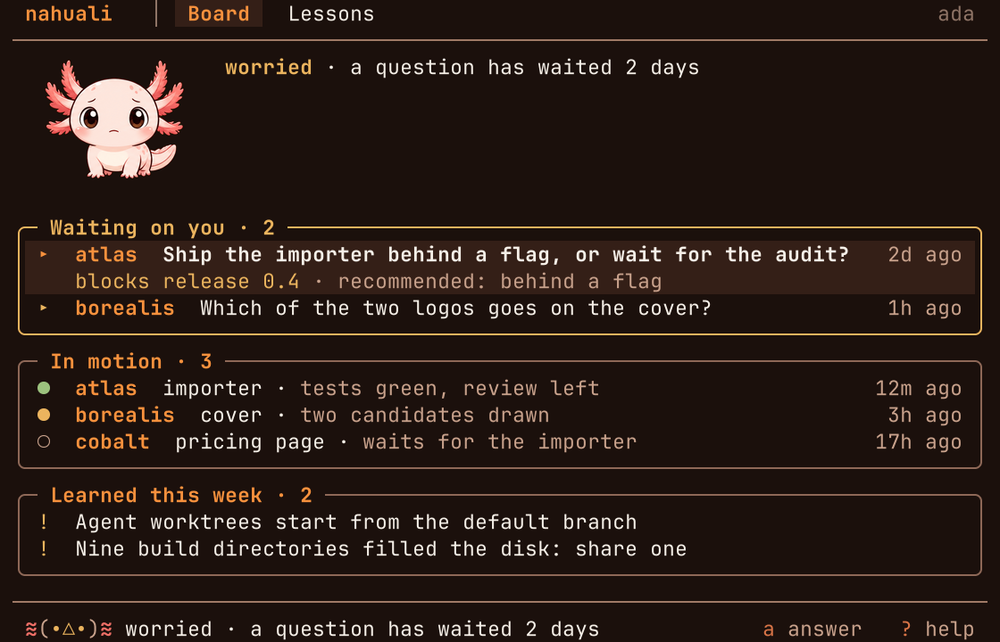

<p align="center">
  
</p>

<p align="center">
  
  
  
  
</p>

# nahuali

**A working memory for a person and their agents. It says where things stand, what is waiting on you, what was learned, and how far each of those can be trusted.**

When several agents work for you on several projects, the state of the work lives in chat scrollback and in each agent's head. Nahuali gives it one place. An agent says where its work stands and asks what it needs you to decide. You open one board, answer with one key, and the answer is where the agent looks next. What went wrong once is told to the next agent at the moment it is about to do it again.

Nothing in it is a bare statement. Every card, question and decision carries who said it, whether it was verified or only claimed, when, and at which commit.

> [!NOTE]
> Nahuali is being built and has no release yet. It runs from source. The eight verbs of its design exist: `status`, `update`, `ask`, `answer`, `learn`, `check`, `note` and `recall`. The screens on this page are drawn by the real interface on invented data.

## Why

These happened in one working week, and each is a failure of memory, not of the model.

- After hours of work, nobody can say where things stand without digging through git and old messages.
- A question for the person is asked at the end of a long message, goes unanswered, and is asked again ten times because it lives nowhere.
- A lesson is written down somewhere and arrives after the mistake is made again.
- Automatic recall brings in something unrelated, once something private.
- Nobody can tell what was verified from what an agent merely reported.
- Writing things down costs a forced paragraph at every stop.

## What it holds

| Thing | What it is | Its life |
| --- | --- | --- |
| Work | A named piece of work with one card: what is true now, what is done, what is next | The card is overwritten. Its past stays readable behind it |
| Ask | A question for you, with what it blocks and the answer the agent would give | Open and in sight until someone closes it. It never expires |
| Decision | An answered ask | Kept, with who decided |
| Lesson | A rule learned from a failure, with the moment it applies | Shown when that moment comes. Retired when it stops being true |
| Note | Something worth knowing | Kept until it goes stale and is forgotten |

Every one of them carries the same four marks.

| Mark | Says |
| --- | --- |
| who | You said it, an agent saw it, or an agent passes on what another told it |
| how sure | Verified, and by what, or only claimed |
| as of | The moment and, for work in a repository, the commit |
| reach | The project it belongs to, and whether it is private to it |

## What it looks like

<table>
  <tr>
    <td width="50%" valign="top">
      
      <br><sub>The board. What waits on you comes first, then the work, and how much of it is verified.</sub>
    </td>
    <td width="50%" valign="top">
      
      <br><sub>A question, with what it blocks, what the agent recommends, and its marks.</sub>
    </td>
  </tr>
  <tr>
    <td width="50%" valign="top">
      
      <br><sub>A piece of work. The card says what is true now, and its past is one step behind.</sub>
    </td>
    <td width="50%" valign="top">
      
      <br><sub>Asking the memory. What the words find comes first; what only the meaning finds is apart, and says so.</sub>
    </td>
  </tr>
  <tr>
    <td width="50%" valign="top">
      
      <br><sub>The same board at 80×24. The axolotl falls back to half blocks where a terminal has no images.</sub>
    </td>
    <td width="50%" valign="top"></td>
  </tr>
</table>

The axolotl is not decoration. It is worried when a question has waited two days, listening when one is open, thinking when work is blocked, and happy when nothing waits on you.

## How agents use it

Through one small command. The project, the commit and the time are recorded for the agent, so it adds only judgement.

```sh
nahuali status                       # before starting: open asks, the cards, what was decided lately
nahuali update importer \
  --line "tests green, review left" \
  --done "parser for the old format" \
  --next "open the review" \
  --verified "cargo test, 42 passing"   # without this the update is recorded as only claimed
nahuali ask "Ship behind a flag, or wait for the audit?" \
  --work importer --blocks "release 0.4" --recommends "behind a flag"
nahuali answer k3f9q2 "Behind a flag."  # closes the ask. It is now a decision
```

This is what an agent reads when it starts.

```text
atlas · 1 waiting on the person · 2 pieces of work

WAITING ON THE PERSON
  ask:k3f9q2  Ship behind a flag, or wait for the audit?
              blocks release 0.4 · holds importer · recommends behind a flag
              asked by claude-code, an agent · 2 d ago

WORK
  importer  waiting on ask:k3f9q2 · tests green, review left
            done: parser for the old format
            next: open the review
            claude-code · verified by cargo test, 42 passing · 12 min ago · commit abc1234
  pricing   not started
            codex · claimed · 1 d ago

DECIDED IN THE LAST 7 DAYS
  ask:9x8y7z  Which of the two logos goes on the cover?
              answer: The blue one.
              decided by ada · 3 h ago
```

A piece of work is never set to "waiting on the person" by hand. It waits while an open ask names it and stops waiting when that ask is closed. An agent that answers an ask itself is shown as an agent.

### A lesson arrives at the moment of the act

A lesson has a rule and the moment it applies. It is not read out at the start of a session, where it would be one more paragraph to skim. It is shown when an agent is about to do the thing it is about.

```sh
nahuali learn "Agent worktrees start from the default branch, not from the branch you are on" \
  --moment "before spawning an agent in its own worktree" \
  --when "worktree add"
```

```text
$ git worktree add ../atlas-side -b side

nahuali · learned before, and it applies to what you are about to do
  lesson:k39s92  Agent worktrees start from the default branch, not from the branch you are on
                 when: before spawning an agent in its own worktree
                 matched: add, worktree · learned by claude-code, an agent · 3 d ago · shown twice
```

| Rule | In practice |
| --- | --- |
| Its words decide | A lesson applies when the words that mark its moment are in the command as a phrase: in their order and almost unbroken. What a command writes, a script or a file's text, does not count. The answer is the same every time and says which words brought it |
| Strict | Half a moment is not the moment. "No lesson applies" is the usual answer |
| Once per session | An agent that has been told is not told again |
| It can stop the act | A lesson marked `--stop` refuses the command once. Running it again goes through, and the stop is recorded |
| Meaning is for whoever asks | `nahuali check` also shows lessons close in meaning, marked as likenesses. Before a command, unasked, only the words speak: replayed on 600 real commands, meaning brought five lessons and none was needed |
| Measured on real work | On 600 real commands a lesson was brought fourteen times, twelve of them exactly where it belonged, in sixteen milliseconds a command |
| It can be wrong | `nahuali retire` takes a lesson out when it stops being true |

With `nahuali setup --hooks` this runs by itself before each command in Claude Code and in Codex. Anywhere else an agent asks: `nahuali check "what I am about to do"`.

### Recall that can come back empty

```sh
nahuali note "The audit is on the 20th; the client sends the files a week before" --tag dates
nahuali recall "audit"
```

```text
atlas · 2 things known about "audit"
  decision:n2kmb3  Ship the importer behind a flag?
                   answer: Behind a flag, until the audit.
                   decided by ada · 2 d ago
  note:yzsycy  The audit is on the 20th; the client sends the files a week before
               tags: dates
               claude-code, an agent · 5 d ago
```

Recall searches the cards, the decisions, the lessons and the notes with the database's full-text index. A word finds its other forms, so `exporting` finds `exports` and `decision` finds `decisión`. Every word asked for has to be there, nothing private to another project is ever offered, and "nothing known" is a normal answer that an agent is told to repeat instead of guessing.

### What is said in other words

```sh
nahuali setup --meaning     # once: a multilingual model, 220 MB, that runs on this machine
nahuali recall "cuándo es la auditoría"
```

```text
atlas · nothing holds the words "cuándo es la auditoría"; 1 thing is close in meaning

CLOSE IN MEANING (not the same words; judge them)
  note:bzpnpp  The audit is on the 20th; the client sends the files a week before
               tags: dates
               claude-code, an agent · 5 d ago · 0.70 alike
```

With the model installed every thing also carries a vector, kept in the database beside its words. Nothing leaves the machine: the model runs in the keeper, on the CPU, in about seven milliseconds a question.

What the words find always comes first and is called a match. What only the meaning finds comes after, apart, with how alike it is, and is called a likeness. The line below which nothing is offered was measured, not guessed: at 0.65, eight of nine things offered were answers, and half of the answers that shared no word were found. `cargo run --release -p nahuali-embed --example near -- MODELS_DIR` repeats the measurement.

### Your own machines

```sh
nahuali node listen                                  # on the computer that stays on at home
NAHUALI_KEY=… nahuali node join pc.local:8746        # once, on each of your other machines
```

Every machine keeps a whole memory and works with no network. When two of them can see each other, each takes from the other the events it lacks. A memory is a set of events that never change, so there is nothing to merge and nothing to decide: the same events give the same state everywhere.

| Rule | In practice |
| --- | --- |
| Local first | A machine out of reach works on, and catches up when it is back |
| One that stays on is enough | Two laptops that only ever go to the computer at home end up holding the same |
| No server to install | The machine at home runs `nahuali`, nothing else |
| Sealed with one key | Drawn once and shared by your machines. Someone else on the Wi-Fi can neither read a message nor put an event in |

How to set up the machine at home, on Linux or inside Windows with WSL, is in [`docs/home.md`](docs/home.md).

### A team

```sh
nahuali team init ws://memory.example.com:8000    # once, by whoever runs the SurrealDB server
nahuali team add bob ws://memory.example.com:8000 # prints the passphrase bob joins with, once
NAHUALI_PASS=… nahuali team join ws://memory.example.com:8000 --name bob
```

Several people, each with their own agents, on one memory. Every verb works as before, and two things are new.

```sh
nahuali ask "Which of the two logos goes on the cover?" --to bob   # it waits on bob's board, not yours
nahuali note "What I want to raise in my review" --mine           # only you and your agents ever see it
```

| Rule | Who keeps it |
| --- | --- |
| A person reads what is shared and what is only theirs | The database server. What is only someone else's is never sent to your machine |
| A person writes only in their own name | The database server. A changed copy of Nahuali cannot write as someone else |
| Nothing written is changed or deleted | The database server |
| A line cannot say another person spoke | Every reader. It is read as its own person reporting what the other said |

No copy of Nahuali has to be trusted for these to hold: they are permissions of the SurrealDB server, defined by `nahuali team init`, and running it again brings a server to the current ones. Each machine keeps its own keeper, which signs in as its person and keeps the search index and the vectors on its own disk. `nahuali team leave` goes back to the memory on the machine, which was never touched.

### Any tool

```sh
nahuali setup            # writes the one page an agent reads, for Claude Code and Codex
nahuali setup --hooks    # also, in Claude Code and Codex: the board at the start of a session, lessons before a command
nahuali mcp              # the same eight verbs over the Model Context Protocol
nahuali doctor           # whether every part is right, and what to do about the ones that are not
```

With the hooks, an agent is also reminded when its card may be old: when you next speak and there were commits since the card was written, once for each commit, stopping nothing.

`nahuali setup --remove` takes out exactly what it put in and leaves the tools' own files as they were. What an agent is told about Nahuali is one page: [`skills/nahuali/SKILL.md`](skills/nahuali/SKILL.md).

## The memory is yours

The memory lives in a database on your own machine, an embedded [SurrealDB](https://surrealdb.com), and comes out of it as plain lines of text whenever you ask.

```text
~/.local/share/nahuali/
  db/                  the database
  log/*.jsonl          lines to take in, from an export or from another machine
```

| Property | In practice |
| --- | --- |
| Nothing to install or manage | The first command that needs the memory starts the one process that keeps the database open. It leaves by itself when nobody speaks to it. No service, no password |
| Many at once | The board stays open while a dozen agents write. They all talk to that one keeper |
| Out as plain text | `nahuali export` prints every event as one line of JSON, with the time, who wrote it, how sure they were and what happened |
| In again, anywhere | A memory takes in the lines it finds in its `log/` folder, each one once. A backup, a move to another machine and two machines sharing a memory are all that same step |
| Order does not matter | The state is the events in order of their time. The same events give the same state wherever they came from and however often they arrive |

The whole format is in [`docs/format.md`](docs/format.md).

## How it works

```text
agents ── nahuali update / ask ──▶ the keeper ◀── nahuali answer ── you, on the board
                                       │
                                       ├─ SurrealDB: every event, added and never changed
                                       └─ folded in order of time ─▶ cards, open asks, decisions
```

Everything that happens is one event, added and never changed. What is true now is those events folded in order, so any card can be explained by the events behind it.

The rules live in [`nahuali-core`](crates/nahuali-core), which has no clock, no network and no process of its own, and does not know where events are kept. Whatever runs it says what time it is and who is speaking. Behind the command it is kept by SurrealDB. It also ships a store of plain files with no database at all, for a machine too small or too simple to run one.

| Crate | What it is |
| --- | --- |
| [`nahuali-core`](crates/nahuali-core) | The events, the fold and the verbs |
| [`nahuali-cli`](crates/nahuali-cli) | The `nahuali` command, the keeper of the database, the hooks and the MCP server |
| [`nahuali-embed`](crates/nahuali-embed) | The model that turns text into vectors, run in process on the CPU |
| [`nahuali-view`](crates/nahuali-view) | The screens as a view model, with no dependencies |
| [`nahuali-tui`](crates/nahuali-tui) | The terminal renderer, with the animated axolotl |

## Running it

It needs a Rust toolchain.

```sh
cargo install --path crates/nahuali-cli
nahuali help
```

To see the interface on invented data, without a memory of your own:

```sh
cargo run -p nahuali-tui --example board
```

## Self-hosted, and a cloud beside it

Nahuali is meant to be open source that you run on your own machine or server, with a hosted service beside it for those who would rather not run it. The hosted service will run this same program, one separate installation per customer. Nothing is held back from the open version to make the hosted one better.

This repository is kept, from its first commit, as if it were already public. What belongs in it and what never does is in [`docs/boundaries.md`](docs/boundaries.md).

## What it does not do yet

- On one machine it does not prove who is speaking: "who" is what the speaker declared. On a team's server the person is proven by their passphrase, and their agents are still whoever they say they are.
- A team's passphrase is kept in a file only your user can read, not in a keychain.
- It does not encrypt. The memory is as private as the disk it is on.
- It does not run on Windows itself. It runs on Linux inside Windows (WSL), where it has not been tried yet.
- Meaning is a likeness, not an understanding. It finds about half of what is said in other words and is kept apart from what the words find. Without the model there are only the words.
- The hooks are for Claude Code and Codex. Codex runs them only after you review them once, in its `/hooks`. Other tools use the command or MCP.

## Roadmap

In this order, each when it is done. There are no dates.

1. ~~The cards and the asks, the verbs `status`, `update`, `ask` and `answer`, and the board on real work.~~
2. ~~Lessons, and `check`. An agent about to do something is told the lessons that apply, at that moment.~~
3. ~~Notes and `recall`, strict enough that an empty answer is a normal one.~~
4. ~~The same verbs over MCP, so no agent tool is special.~~
5. ~~Search by meaning beside search by words, on this machine.~~
6. ~~A team: several people on one memory, each seeing what reaches them.~~
7. ~~Your own machines: each with its memory, brought together when they meet.~~
8. Releases you can install without a toolchain.

A hosted service is not on this list. It may come one day; for now Nahuali is for one person, their agents and their own machines.

The definition the design starts from is [`docs/product.md`](docs/product.md).

## Brand

In Mesoamerican tradition a nahual is a person's animal double. The axolotl is ours. It never finishes growing up and it grows back what it loses, which is a fair description of a memory worth having. The name Nahuali and the axolotl are not covered by the licence of the code ([`assets/README.md`](assets/README.md)).

## License

Not chosen yet. It is chosen on the day this repository is published.
